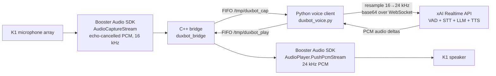

# DUXBOT v1: Brazilian Portuguese Voice for the Booster K1

A real-time, speech-to-speech conversational system built **specifically for the Booster K1 EDU** humanoid. It replaces the robot's stock conversational path with a streaming voice model so the K1 can talk with people in **Brazilian Portuguese**, using the robot's own microphone array and speaker through the Booster Audio SDK.

Written in May and June 2026 for the K1 at a Brazilian school, at DUX Educacional (an official Booster Robotics partner in Brazil). To our knowledge, it was the first implementation of fluent Brazilian Portuguese conversation on the Booster K1.

This repository is v1 only, written in Python and C++ before a teammate joined. The project was later continued in Go and grew into a larger system co-developed with that teammate; that code is not part of this repository.

## Why this exists

The K1's stock conversational agent supports Chinese and English. A K1 in a Brazilian school, however, talks to students, parents, teachers, and visitors who speak Portuguese. Adding a "respond in Brazilian Portuguese" instruction to the stock agent's configuration had no effect: the underlying model ignored it. The robot could be shown off, but it could not hold a conversation with the people it was there for.

## Why it is built around the K1 hardware and SDK

The robot's audio path is the hard part, and it is specific to the K1:

- The K1's microphone array is only reliably reachable through the **Booster Audio SDK** (C++). An earlier all-C++ attempt that bypassed the SDK (using PulseAudio) conflicted with the robot's stock conversational app, so v1 goes through the SDK instead.
- The SDK provides an **echo-cancelled (NAEC)** capture stream. A talking robot hears itself, so using that stream keeps the model from reacting to its own voice.
- Playback goes through the SDK's `AudioPlayer` as a raw PCM stream, which lets the model's audio be pushed straight to the robot's speaker as it arrives.
- The Booster SDK is C++ while an async WebSocket client is far simpler in Python, so the system is split into two processes joined by FIFOs.

## Architecture



### Components

**`bridge/duxbot_bridge.cpp` (C++).** Initializes the Booster DDS channel and `AudioManager`, captures the NAEC stream and writes raw PCM to a FIFO, and reads response PCM from a second FIFO and pushes it to the `AudioPlayer`. Runs on the robot (aarch64).

**`voice/duxbot_voice.py` (Python).** Reads the capture FIFO in a thread, resamples 16 kHz to 24 kHz (linear interpolation), and streams chunks to the xAI Realtime API over a WebSocket. Configures the session with the DUXBOT persona, a voice, and server-side voice activity detection (VAD). Writes the model's audio to the playback FIFO. Reconnects automatically when the connection drops, and also reconnects after 180 seconds of inactivity to reset the conversation context.

### Design decisions

- **Speech-to-speech instead of STT → LLM → TTS.** One streaming session removes inter-stage latency and lets the server's VAD handle turn-taking.
- **Two processes joined by FIFOs.** The voice client can crash or restart without tearing down the audio hardware; the bridge ignores `SIGPIPE` for exactly that case.
- **Persona in the session instructions.** The system prompt defines the robot's identity (a school reception assistant, ambassador for the school's technology programs, and learning companion that prompts reasoning rather than just answering), its tone, safety rules, and a Brazilian Portuguese language and pronunciation policy. Behavior can be changed without touching the audio path.
- **Frame dropping under backlog.** If the queue fills, capture frames are dropped rather than letting latency grow.
- **Context reset on idle.** After a period of inactivity the session is recreated so one visitor's conversation does not leak into the next.

## Applications

In the configuration included here, the robot acts as: a reception assistant for visitors and families, an ambassador for the school's technology and robotics programs, an AI-literacy companion for students, and a demonstrator at events.

## Status

Ran on a physical K1 EDU: bridge capture, API connection, VAD, transcription, Portuguese responses, and audio through the robot's speaker. No latency or accuracy measurements were taken, so none are claimed here.

## Requirements

- Booster K1 (aarch64 Linux) and the Booster Robotics SDK. **The SDK is not included**; obtain it from Booster Robotics and follow its license.
- CMake ≥ 3.15 and a C++17 compiler (bridge).
- Python 3.9+ with `numpy` and `websockets>=14` (voice client).
- An xAI API key.

## Build and run

```bash
# 1. Build the bridge (on the robot)
cd bridge
cmake -S . -B build -DSDK_ROOT=/path/to/booster_sdk
cmake --build build

# 2. Configure the key (never commit config.env)
cp config.env.example config.env   # then edit it
export $(grep -v '^#' config.env | xargs)

# 3. Install the voice client dependencies
pip install -r voice/requirements.txt

# 4. Start the bridge first, then the voice client
./build/duxbot_bridge &
python3 ../voice/duxbot_voice.py
```

The bridge blocks until the voice client opens the capture FIFO, so start it first. The robot's stock conversational agent must not be running at the same time, since both would contend for the audio hardware.

## Limitations

- **No barge-in.** The client logs when the user starts speaking but does not stop playback of the robot's current answer.
- **Speech only.** An early prototype let the model trigger robot movements from its own speech. It never worked reliably and was removed, so this version does not move the robot. Any future motion control would need a proper safety layer, because commands inferred from generated text are unsafe on a physical robot.
- **Linear-interpolation resampling** with no anti-aliasing filter. Adequate for speech; not high fidelity.
- **Persona is hardcoded** in the Python source rather than loaded from configuration.
- **No automated tests.** Validation was done by speaking to the robot.
- **Needs internet access** to the xAI API; v1 has no offline fallback.
- Requires a K1 and the Booster SDK; there is no simulator or mock bridge.

## Security

The API key is read only from the `XAI_API_KEY` environment variable. `config.env` is git-ignored; real keys must never be committed.

## Author

Luiz Felipe Conceição · DUX Educacional
